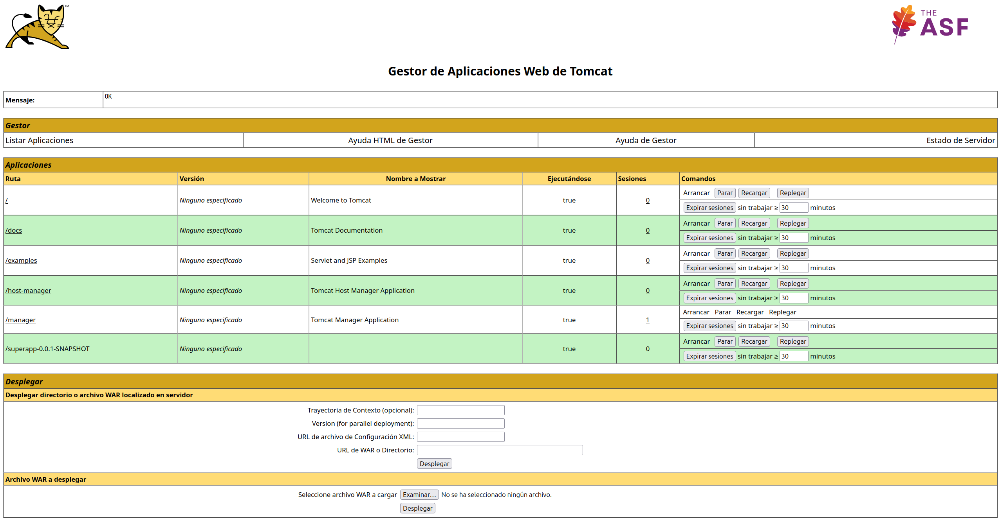

# Despliegue de aplicaciones en Tomcat

Para acabar esta sección, vamos a ver cómo desplegar aplicaciones web en el servidor de aplicaciones Tomcat. El despliegue de aplicaciones web en Tomcat se realiza mediante la copia del archivo WAR (Web Application Archive) de la aplicación web en el directorio `webapps` del servidor de aplicaciones.

Vamos a utilizar el fichero WAR que hemos generado en el ejercicio anterior para desplegar la aplicación web en Tomcat. Para ello, sigue los siguientes pasos:

1. Copia el archivo WAR de la aplicación web en el directorio `webapps` del servidor de aplicaciones Tomcat. Por ejemplo, si has instalado Tomcat en `/opt/tomcat`, copia el archivo WAR en `/opt/tomcat/webapps`.

2. Una vez copiado el archivo WAR, Tomcat detectará automáticamente la nueva aplicación web y la desplegará en el servidor de aplicaciones. Puedes verificar que la aplicación web se ha desplegado correctamente accediendo a la URL `http://localhost:8080/nombre_de_la_aplicacion`, donde `nombre_de_la_aplicacion` es el nombre del archivo WAR sin la extensión `.war`.

!!! info

    Es posible que muestre un error 404; esto es debido a que el Servlet asociado esta en la URL: [http://localhost:8080/webservlets-1.0-SNAPSHOT/myservlet](http://localhost:8080/webservlets-1.0-SNAPSHOT/myservlet)

## Configuración de la aplicación web en Tomcat

Vamos a ver el estado de la aplicación web desplegada en Tomcat. Para ello, vamos a revisar el Manager de Tomcat, que es una herramienta web que permite administrar las aplicaciones web desplegadas en el servidor de aplicaciones.

Para acceder al Manager de Tomcat, abre un navegador web y accede a la URL `http://localhost:8080/manager/html`. Se te pedirá que introduzcas un nombre de usuario y una contraseña. Introduce las credenciales del usuario administrador que has configurado en el fichero `tomcat-users.xml` en el apartado anterior.

Nos solicitará un usuario y una contraseña, introduce el usuario y la contraseña que hemos configurado en el fichero `tomcat-users.xml` en el apartado anterior.

Manager de Tomcat nos permite ver el estado de las aplicaciones web desplegadas en el servidor de aplicaciones, incluyendo la aplicación web que acabamos de desplegar. Desde el Manager de Tomcat, podemos iniciar, detener, reiniciar y eliminar aplicaciones web, así como ver los registros de la aplicación web y configurar parámetros adicionales.

<figure>
    
    <figcaption>Manager de Tomcat</figcaption>
</figure>

Podemos comprobar que nuestra aplicación web se ha desplegado correctamente y está en estado "Running". Además, podemos ver el nombre de la aplicación web, la URL de acceso y el tamaño del archivo WAR.

Para parar la aplicación web, podemos hacer clic en el botón "Stop" junto al nombre de la aplicación web. Esto detendrá la aplicación web y cambiará su estado a "Stopped". Para iniciar la aplicación web nuevamente, podemos hacer clic en el botón "Start" junto al nombre de la aplicación web.

Podemos ver nuestra aplicación si accedemos a la siguiente URL:

[http://localhost:8080/webservlets-1.0-SNAPSHOT/myservlet](http://localhost:8080/webservlets-1.0-SNAPSHOT/myservlet)