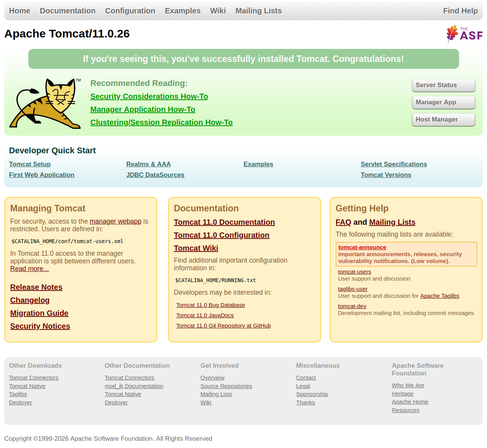

# Servidor de aplicaciones Tomcat

El servidor de aplicaciones Tomcat es un servidor de aplicaciones de código abierto, desarrollado por la Apache Software Foundation, que implementa las especificaciones de Java Servlet y JavaServer Pages (JSP). Es uno de los servidores de aplicaciones más populares y utilizados en el mundo del desarrollo web.

Este servidor de aplicaciones es ligero y fácil de usar, lo que lo hace ideal para el desarrollo y despliegue de aplicaciones web basadas en Java. Además, Tomcat ofrece características avanzadas como la gestión de transacciones, la seguridad y la integración con bases de datos y otros servicios.

Algunas de sus características principales son:

* **Compatibilidad con Java**: Tomcat es compatible con las especificaciones de Java Servlet y JSP, lo que permite a los desarrolladores crear aplicaciones web dinámicas utilizando estas tecnologías.

* **Ligero y fácil de usar**: Tomcat es un servidor de aplicaciones ligero y fácil de usar, lo que lo hace ideal para el desarrollo y despliegue de aplicaciones web basadas en Java.

* **Gestión de transacciones**: Tomcat ofrece soporte para la gestión de transacciones, lo que permite a los desarrolladores garantizar la consistencia y la integridad de los datos en sus aplicaciones web.

* **Seguridad**: Tomcat ofrece características de seguridad avanzadas, como la autenticación y autorización de usuarios, la protección contra ataques de denegación de servicio (DoS) y la gestión de certificados SSL.

* **Integración con bases de datos**: Tomcat ofrece soporte para la integración con bases de datos y otros servicios, lo que permite a los desarrolladores crear aplicaciones web más complejas y funcionales.

* **Escalabilidad**: Tomcat es capaz de manejar múltiples solicitudes simultáneamente, lo que permite a los desarrolladores crear aplicaciones web escalables y de alto rendimiento.

* **Comunidad activa**: Tomcat cuenta con una comunidad activa de desarrolladores y usuarios, lo que permite a los desarrolladores obtener soporte y compartir conocimientos sobre el uso del servidor de aplicaciones.

<figure>
  
  <figcaption>Apache Tomcat Logo</figcaption>
</figure>

## Instalación y configuración de Tomcat

En primer lugar, vamos a ver los pasos para poder instalar y configurar tomcat. Hay que instalar Java Development Kit (JDK) en el sistema, ya que Tomcat requiere Java para funcionar. Puedes descargar e instalar la versión más reciente del JDK desde el sitio web oficial de Oracle o utilizar una distribución de OpenJDK.

A continuación, descarga la versión más reciente de Apache Tomcat desde el sitio web oficial de Apache Tomcat. Asegúrate de elegir la versión compatible con tu sistema operativo y la versión de Java que has instalado.

[Descarga de Apache Tomcat](https://tomcat.apache.org/download-11.cgi)

Una vez descargado el archivo comprimido, descomprímelo en un directorio de tu elección. Por ejemplo, puedes descomprimirlo en `/opt/tomcat` en sistemas Linux o en `C:\tomcat` en sistemas Windows.

### Configuración de variables de entorno

Aunque por defecto no es necesario configurar variables de entorno para ejecutar Tomcat, es recomendable establecer la variable de entorno `JAVA_HOME` para que apunte al directorio donde se encuentra instalado el JDK. Esto permitirá a Tomcat encontrar y utilizar la versión correcta de Java.

Estas variables de entorno son:

* **JAVA_HOME**: Debe apuntar al directorio donde se encuentra instalado el JDK.
* **CATALINA_HOME**: Debe apuntar al directorio donde se encuentra instalado Tomcat.
* **CATALINA_BASE**: Debe apuntar al directorio donde se encuentra la instancia de Tomcat que deseas ejecutar. Por defecto, este valor es el mismo que `CATALINA_HOME`, pero puedes configurarlo para ejecutar múltiples instancias de Tomcat en el mismo sistema.
* **CATALINA_OPTS**: Permite establecer opciones de configuración adicionales para la JVM utilizada por Tomcat, como la cantidad de memoria asignada o las opciones de depuración.

## Arranque y parada de Tomcat

Para ejecutarlo, abre una terminal o línea de comandos y navega hasta el directorio `bin` dentro del directorio de Tomcat. Ejecuta el script `startup.sh` en sistemas Linux o `startup.bat` en sistemas Windows para iniciar el servidor de aplicaciones.

En este caso, puedes abrir un navegador web y acceder a la URL `http://localhost:8080` para verificar que Tomcat se ha iniciado correctamente. Deberías ver la página de bienvenida de Tomcat.

<figure>
  
  <figcaption>Página de bienvenida de Tomcat</figcaption>
</figure>

Para detener el servidor de aplicaciones, ejecuta el script `shutdown.sh` en sistemas Linux o `shutdown.bat` en sistemas Windows desde el mismo directorio `bin`. Esto detendrá el servidor de aplicaciones de manera segura.